  

  

  

  
  &nbsp;
  

 

I'm an **AI Engineer & Data Scientist** from Egypt. I build:

- **AI chatbots (RAG)** that answer from your PDFs, cite the page, and say *"not in the documents"* instead of making things up
- **Machine learning models** tested the honest way: cross-validation, backtests, no data leakage
- **Dashboards** in Power BI and Streamlit that people actually use
- **Data extraction and scraping**: PDFs, invoices, websites and APIs into clean Excel

CS student at Assiut University &nbsp;·&nbsp; Led my team to **3rd place nationally** at DEPI &nbsp;·&nbsp; Arabic and English

 
 

<table>
  <tr>
    <td width="50%" valign="top">
      
      <h3><a href="https://github.com/Tadrous-William/rag-pdf-chat">Chat with your PDFs</a></h3>
      RAG chatbot that answers only from your files and shows the page. Runs 100% locally.  
      <b>Result:</b> 30 / 30 test questions right  
        
    </td>
    <td width="50%" valign="top">
      
      <h3><a href="https://github.com/Tadrous-William/ai-invoice-extraction">AI Invoice Extraction</a></h3>
      Invoices and receipts (PDFs, scans, photos) into checked Excel data with a local LLM and OCR.  
      <b>Result:</b> tested on 206 documents  
        
    </td>
  </tr>
  <tr>
    <td width="50%" valign="top">
      
      <h3><a href="https://github.com/Tadrous-William/nyc-real-estate-dashboard">NYC Real Estate Dashboard</a></h3>
      Investor dashboard with market trends, a home price estimator and rental yields.  
      <b>Result:</b> built on 367,189 real property sales  
       
    </td>
    <td width="50%" valign="top">
      
      <h3><a href="https://github.com/Tadrous-William/powerbi-sales-dashboard">Power BI Sales Dashboard</a></h3>
      SQL cleaning, a 4-page Power BI report and an insights deck with 5 recommendations.  
      <b>Result:</b> 1.07M order lines analysed  
       
    </td>
  </tr>
  <tr>
    <td width="50%" valign="top">
      
      <h3><a href="https://github.com/Tadrous-William/sales-forecasting">Sales Forecasting & Stock Plan</a></h3>
      Weekly demand forecast with a low–high range and a stock plan for 200 products.  
      <b>Result:</b> backtested on 7 dates against 5 simple methods  
       
    </td>
    <td width="50%" valign="top">
      
      <h3><a href="https://github.com/Tadrous-William/business-lead-list">B2B Lead List Builder</a></h3>
      Scored lead list built only from public sources, with phone, contact, website and email checks.  
      <b>Result:</b> 9,485 Texas dental practices  
       
    </td>
  </tr>
</table>

 

| Project | What it is | Result |
|---|---|---|
| [Satellite Land Classification](https://github.com/Tadrous-William/sentinel2-land-classification) | EfficientNet on Sentinel-2 images | **97% accuracy, 3rd place nationally** |
| [Breast Cancer Classification](https://github.com/Tadrous-William/breast-cancer-classification) | 7 models compared | **97.4% accuracy, 0.999 AUC** |
| [Loan Approval Classification](https://github.com/Tadrous-William/loan-approval-classification) | XGBoost credit risk model | **93% accuracy on 45,000 loans** |
| [Student Performance Prediction](https://github.com/Tadrous-William/student-performance-prediction) | Exam score regression | **R² 0.83** |
| [Assisted Living Data Extraction](https://github.com/Tadrous-William/assisted-living-data-extraction) | PDF directory to clean CSV | Ready-to-use dataset |
| [Book Scraper](https://github.com/Tadrous-William/book-scraping-project) | Requests + BeautifulSoup | 1,000 books scraped |
| [COVID-19 Data Collection](https://github.com/Tadrous-William/covid19-data-collection-python) | API data pipeline | 15 countries, 2022–2024 |
| [Google Calendar to Sheets](https://github.com/Tadrous-William/google-calendar-to-sheets-automation) | Google APIs automation | One row per event |
| [GLB 3D Model Downloader](https://github.com/Tadrous-William/glb-3d-model-downloader) | Download automation | Batch .glb downloads |
| [AgileFlow](https://github.com/Tadrous-William/AgileFlow-.net) | ASP.NET Core 9 team project | Real-time Kanban with SignalR |
| [MiniFAT file system](https://github.com/Tadrous-William/OS-Tasks) | Operating systems project | FAT file system from scratch |

 

  

  
  
  
  
  
  
  
  
  
  

 

  <picture>
    <source media="(prefers-color-scheme: dark)" srcset="https://raw.githubusercontent.com/Tadrous-William/Tadrous-William/output/github-contribution-grid-snake-dark.svg"/>
    <source media="(prefers-color-scheme: light)" srcset="https://raw.githubusercontent.com/Tadrous-William/Tadrous-William/output/github-contribution-grid-snake.svg"/>
    
  </picture>

 

  Need a chatbot for your documents, a model you can trust, or a dashboard your team will use?  
  

